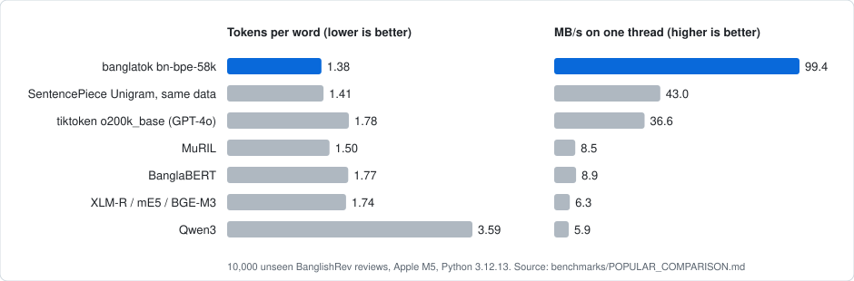

# banglatok

**Fast, lossless subword tokenizers for Bangla, English and Banglish (romanized Bengali), including code-mixed text.**

[](https://pypi.org/project/banglatok/)
[](https://github.com/iamaber/banglatok/actions/workflows/ci.yml)


[](https://huggingface.co/iamaber/banglatok-bn-bpe-58k)
[](#license)

```python
from banglatok import Tokenizer

tok = Tokenizer.from_pretrained()
tok.tokenize("meetingটা ১০টায়, don't be late 🙂")
# ['meeting', 'টা', ' ১০', 'টায়', ',', " don't", ' be', ' late', ' 🙂']
```

banglatok splits real Bangla text, as people type it, into short and reversible token sequences. Use it to train or adapt encoders and LLMs on Bengali, to count tokens against a budget, or to segment text.

- **Fewer tokens.** On product reviews from a source it never trained on, the default model `bn-bpe-58k` emits 22% fewer tokens than BanglaBERT and GPT-4o's `o200k_base`, 21% fewer than XLM-R, mE5 and BGE-M3, 8% fewer than MuRIL, and 62% fewer than Qwen3.
- **Nothing lost.** `decode(encode(text))` returns the normalized text exactly, for every input. There is no `[UNK]` token and no lowercasing. Bengali combining marks, ZWJ and ZWNJ, emoji and mixed scripts all survive the round trip.
- **Fast on one core.** On one Apple M5 thread it encodes 99–119 MB/s of those reviews. That is 2.2–2.9× the speed of SentencePiece Unigram, 2.7–10× tiktoken `o200k_base`, and 11–20× Hugging Face `tokenizers`. Batches of 1,024 texts reach 229 MB/s on all 10 cores.
- **No dependencies.** A Go engine runs behind `ctypes`, so the wheel needs no other Python package and no compiler. The API is typed and thread-safe. All bundled models ship in the wheel with identical native and JSON behavior.



Here is one product review ("The delivery came very late, but the product is good."), split by banglatok and by GPT-4o's tokenizer:

```text
text                        ডেলিভারি অনেক দেরিতে এসেছে কিন্তু প্রোডাক্ট ভালো

banglatok bn-bpe-58k (10)   ডেলি|ভারি| অনেক| দের|িতে| এসেছে| কিন্তু| প্রো|ডাক্ট| ভালো
tiktoken o200k_base  (16)   ড|েল|িভ|ারি| অনেক| দ|ের|িতে| এসেছে| কিন্তু| প্র|ো|ড|াক|্ট| ভালো
```

The same holds for romanized Bengali. `ami kal office e jabo, tumi asbe?` ("I'll go to the office tomorrow, will you come?") is 8 tokens in banglatok and 12 in `o200k_base`.

## Install

We recommend [uv](https://docs.astral.sh/uv/):

```sh
uv add banglatok                  # add it to a uv project
uv pip install banglatok          # or install it into the active virtual environment
uvx banglatok "আমি বাংলা বলি"       # or run the command line once without installing
```

pip works too:

```sh
pip install banglatok
```

Prebuilt wheels cover CPython 3.10–3.15 on Linux (x86_64, aarch64), macOS (x86_64, arm64) and Windows (x86_64). Other platforms build from source, which needs Go 1.24.9 or later and a C compiler. The [install guide](https://github.com/iamaber/banglatok/blob/main/docs/USAGE.md#install) has the details.

## Usage

```python
from banglatok import Tokenizer

tok = Tokenizer.from_pretrained()                    # default "bn-bpe-58k"; try "bn-bpe-28k-v2"
ids = tok.encode("আমি বাংলায় গান গাই। ami banglay gaan gai")
tok.decode(ids)                                      # 'আমি বাংলায় গান গাই। ami banglay gaan gai'
tok.encode_batch(["আমি ভালো আছি", "kemon acho?"])     # many texts, one native call
tok.count_tokens("অনেক লম্বা লেখা…")                  # length without building the list

# Inputs for a model: <s> … </s>, truncation, padding with <pad>.
batch = tok(["আমি ভালো আছি", "hi"], max_length=128, padding=True)
batch["input_ids"], batch["attention_mask"]
```

The same tokenizer works from the shell:

```sh
$ banglatok "আমি বাংলা বলি"
আমি |  বাংলা |  বলি
$ echo "ami bangla boli" | banglatok --ids
4405 33616 34749
$ banglatok --count --model bn-bpe-28k < lines.txt    # one count per line
```

The [user guide](https://github.com/iamaber/banglatok/blob/main/docs/USAGE.md) covers every method, normalization, token strings, the command line, threads and processes, and troubleshooting. It ends with the full API reference.

## Recipes

Each recipe links to a complete, tested version in the user guide.

### Load it in Transformers

The original models are on the Hub, and `transformers` alone can load them.

```python
from transformers import AutoTokenizer

hf = AutoTokenizer.from_pretrained("iamaber/banglatok-bn-bpe-58k")   # same IDs as banglatok
```

To export your own BPE model the same way, call `tok.save_huggingface(directory)`. [Hugging Face guide](https://github.com/iamaber/banglatok/blob/main/docs/USAGE.md#hugging-face)

### Tokenize a dataset

The tokenizer returns plain lists, and `datasets` accepts them as they are.

```python
tokenized = dataset.map(lambda batch: tok(batch["text"], max_length=512), batched=True)
```

[Dataset guide](https://github.com/iamaber/banglatok/blob/main/docs/USAGE.md#tokenize-a-dataset-with-hugging-face-datasets)

### Train a model from scratch

A new model needs only the vocabulary size and the IDs of the control tokens.

```python
from transformers import GPT2Config, GPT2LMHeadModel
from banglatok import BOS_ID, EOS_ID, PAD_ID

model = GPT2LMHeadModel(GPT2Config(vocab_size=tok.vocab_size, n_embd=256, n_layer=4,
                                   n_head=4, bos_token_id=BOS_ID, eos_token_id=EOS_ID,
                                   pad_token_id=PAD_ID))
```

[Training guide](https://github.com/iamaber/banglatok/blob/main/docs/USAGE.md#train-a-small-language-model-from-scratch)

The user guide also shows how to [count tokens against a budget](https://github.com/iamaber/banglatok/blob/main/docs/USAGE.md#count-tokens-and-stay-within-a-budget) and how to [feed a PyTorch DataLoader](https://github.com/iamaber/banglatok/blob/main/docs/USAGE.md#feed-a-pytorch-dataloader).

### Use several processes

Threads can share one tokenizer. Processes must start with the `spawn` or `forkserver` method, because the Go runtime does not survive `fork()`. [Threads and processes](https://github.com/iamaber/banglatok/blob/main/docs/USAGE.md#threads-and-processes)

## Benchmarks

The test set is 10,000 e-commerce reviews from [BanglishRev](https://huggingface.co/datasets/BanglishRev/bangla-english-and-code-mixed-ecommerce-review-dataset), written by real users in Bengali, English, Banglish and mixed script. None of this source is in the training data. Every tokenizer runs on one thread of an Apple M5 with Python 3.12 and banglatok 0.2.4. Speed is the median of five passes, in MB/s, for single calls and for batches of 64.

| Tokenizer | Vocab | Tokens per word ↓ | Lossless round trip ↑ | Texts with UNK ↓ | Single MB/s ↑ | Batch MB/s ↑ |
|---|---:|---:|---:|---:|---:|---:|
| **banglatok `bn-bpe-58k`** | 57,925 | **1.379** | **100%** | **0** | 99.4 | **119.4** |
| **banglatok `bn-bpe-28k`** | 27,760 | 1.587 | **100%** | **0** | **101.1** | 118.6 |
| SentencePiece Unigram, same data and size as `bn-bpe-58k` | 57,925 | 1.410 | 100% | 0 | 43.0 | 40.9 |
| SentencePiece BPE, same data and size as `bn-bpe-58k` | 57,925 | 1.407 | 100% | 0 | 17.4 | 17.1 |
| SentencePiece Unigram, same data and size as `bn-bpe-28k` | 27,760 | 1.572 | 100% | 0 | 45.1 | 43.1 |
| SentencePiece BPE, same data and size as `bn-bpe-28k` | 27,760 | 1.578 | 100% | 0 | 16.4 | 16.3 |
| BNLP `bn_spm` (SentencePiece) | 50,000 | 1.825 | 80.1% | 1,932 | 39.0 | 38.0 |
| tiktoken `o200k_base` (GPT-4o) | 200,019 | 1.780 | 100% | 0 | 36.6 | 12.4 |
| BanglaBERT (csebuetnlp) | 32,000 | 1.771 | 51.1% | 1,110 | 8.9 | 9.0 |
| MuRIL (Google) | 197,258 | 1.498 | 47.9% | 1,617 | 8.5 | 8.7 |
| XLM-R / multilingual-E5 / BGE-M3 | 250,002 | 1.740 | 98.2% | 109 | 6.3 | 6.3 |
| mBERT cased | 119,547 | 2.122 | 48.0% | 1,706 | 7.9 | 8.0 |
| Qwen3 | 151,669 | 3.588 | 100% | 0 | 5.9 | 5.9 |

Batches can also use every core. On all 10 cores of the M5, in batches of 1,024 texts, `bn-bpe-58k` encodes these reviews at 229 MB/s and the in-domain validation split at 305 MB/s. Only banglatok was measured this way. The other tokenizers stay on one thread.

How to read the table:

- Compression comes mostly from the training data, not from the algorithm. SentencePiece trained on the same data at the same vocabulary size is within 2% of banglatok. BanglaBERT, XLM-R and tiktoken trail mostly because they were trained on other data or at other vocabulary sizes.
- The speed lead comes from the implementation, and it depends on the CPU. On the M5, banglatok is 2.2–2.9× as fast as SentencePiece Unigram. On a 4-vCPU Linux x86_64 VM (AMD EPYC 9V74), it is 1.8–2.5× as fast, at 41 MB/s for single calls and 55 MB/s for batches of 64.
- BanglaBERT is about 3% shorter on Bengali-only text, but it reproduces only half of its inputs. Among lossless tokenizers, `bn-bpe-58k` is the most compact on Bengali, Latin and mixed script.
- Shorter sequences cut compute and context use. They do not by themselves make a downstream model more accurate.

The [full report](https://github.com/iamaber/banglatok/blob/main/benchmarks/POPULAR_COMPARISON.md) adds the per-script breakdown, the in-domain validation split, more tokenizers, the method, the limitations and the commands to reproduce every number.

## Models

| Name | Vocab | Choose it for |
|---|---:|---|
| `bn-bpe-58k` (default) | 57,925 | The shortest sequences |
| `bn-bpe-28k-v2` | 27,760 | The best current smaller model |
| `bn-bpe-28k` | 27,760 | Compatibility with original 28k token IDs |

All models are BPE vocabularies with *space fusion*. A space and the token after
it can share one ID, which removes most standalone space tokens without
reserving a marker character such as `▁`. `bn-bpe-28k-v2` adds licensed Global
Voices Bengali and Storybooks Bangladesh training text; it uses no YouTube,
viewer-comment or synthetic text. The original models are on the Hub at
[`iamaber/banglatok-bn-bpe-58k`](https://huggingface.co/iamaber/banglatok-bn-bpe-58k)
and
[`iamaber/banglatok-bn-bpe-28k`](https://huggingface.co/iamaber/banglatok-bn-bpe-28k).

Their IDs differ from those of pretrained encoders such as BanglaBERT or XLM-R,
and the two 28k versions also differ from each other. To pair one with an
existing encoder, you must adapt the encoder's embeddings. In our experiments,
swapping a banglatok vocabulary into multilingual-E5 did not beat the unchanged
model. Treat these vocabularies as a starting point for training a model, not as
a drop-in accuracy gain for an existing encoder.

## Training data

The original models use the Hugging Face dataset [`iamaber/banglatok-training-corpus`](https://huggingface.co/datasets/iamaber/banglatok-training-corpus), with 563,476 training records, 14,779 validation records and 16,712 test records from Bengali Wikipedia, Tatoeba and BanglaTLit. `bn-bpe-28k-v2` adds licensed Global Voices Bengali and Storybooks Bangladesh text after leakage-aware deduplication. Only training splits were used to learn vocabularies, merges and word caches.

Each record keeps its source and attribution. The dataset card explains the source-specific licenses, the filtering and the privacy limitations. The MIT license of the software does not cover the corpus text.

## Train your own

The Go `bntok` command trains Unigram or BPE models on a JSONL corpus, and `Tokenizer(path)` loads the result:

```sh
go run ./cmd/bntok train -algorithm bpe -vocab 384 \
  -input examples/training-records.jsonl -out models/toy-bpe.json
banglatok -m models/toy-bpe.json --json 'আমি বাংলা বলি। ami bangla boli'
python benchmarks/build_fused_model.py --base models/toy-bpe.json --budget 512 \
  --training examples/training-records.jsonl --output models/toy-fused.json
```

[docs/TRAINING_AND_RESEARCH.md](https://github.com/iamaber/banglatok/blob/main/docs/TRAINING_AND_RESEARCH.md) describes the corpus format, the full research pipeline and the model contract.

## Documentation

| Document | Contents |
|---|---|
| [User guide](https://github.com/iamaber/banglatok/blob/main/docs/USAGE.md) | Install, API, command line, Hugging Face, recipes, troubleshooting |
| [Models](https://github.com/iamaber/banglatok/blob/main/docs/MODELS.md) | How the bundled models were built, checksums, limitations |
| [Training dataset](https://huggingface.co/datasets/iamaber/banglatok-training-corpus) | Downloadable splits, sources, attribution, licenses and data limitations |
| [Training and research](https://github.com/iamaber/banglatok/blob/main/docs/TRAINING_AND_RESEARCH.md) | Training your own models, corpus format, model contract |
| [Benchmarks](https://github.com/iamaber/banglatok/blob/main/benchmarks/POPULAR_COMPARISON.md) | Full comparison with popular tokenizers |
| [Changelog](https://github.com/iamaber/banglatok/blob/main/CHANGELOG.md) | Release notes |

## Contributing

[CONTRIBUTING.md](https://github.com/iamaber/banglatok/blob/main/CONTRIBUTING.md) explains how to build, test and change the project. [SECURITY.md](https://github.com/iamaber/banglatok/blob/main/SECURITY.md) explains how to report a vulnerability, and [docs/RELEASING.md](https://github.com/iamaber/banglatok/blob/main/docs/RELEASING.md) how releases are made. Reports from new platforms, regression cases and independent benchmark runs, especially on Windows and Linux arm64, are welcome.

## Citation

If you use banglatok or its models, cite it with the metadata in [CITATION.cff](https://github.com/iamaber/banglatok/blob/main/CITATION.cff).

## License

- Code, documentation and the demo vocabulary: [MIT](https://github.com/iamaber/banglatok/blob/main/LICENSE).
- Bundled model files (`bn-bpe-58k`, `bn-bpe-28k`, `bn-bpe-28k-v2`): [CC BY-SA 4.0](https://github.com/iamaber/banglatok/blob/main/MODEL_LICENSE.md), because they are learned from attributed third-party text.
- Native wheels include BSD-3-Clause Go components ([notices](https://github.com/iamaber/banglatok/blob/main/THIRD_PARTY_NOTICES.md)).

The SPDX expression is `MIT AND BSD-3-Clause AND CC-BY-SA-4.0`. Corpus text keeps its source-specific terms. It is published separately on Hugging Face and is not part of the Python package.
